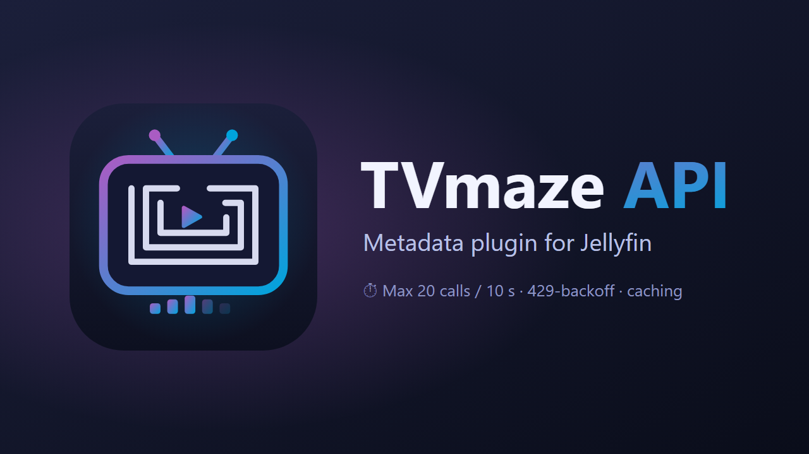

<p align="center">
  
</p>

# TVmaze API til Jellyfin

🇬🇧 [English](README.md) · 🇩🇰 Dansk

Metadata-plugin til [Jellyfin](https://jellyfin.org), der henter serie-, sæson- og episodedata fra [TVmaze-API'et](https://www.tvmaze.com/api) — og overholder TVmaze' rate limit.

## Funktioner

- **Serier:** titel, beskrivelse, genrer, rating, premiere/slutdato, status, sendetid/-dage, netværk/streamingtjeneste, skuespillere og eksterne id'er (TheTVDB, IMDb, TVRage).
- **Sæsoner:** navn, beskrivelse, datoer og plakat.
- **Episoder:** titel, beskrivelse, sendedato, spilletid, rating og stillbillede. Specials (sæson 0) matches i sendefølge, og daglige shows kan matches på dato.
- **Billeder:** plakater, bannere, baggrunde og logoer.
- **Links** tilbage til TVmaze på hvert element.

## Sådan overholdes API-reglerne

| TVmaze-regel | Hvad pluginet gør |
|---|---|
| Mindst 20 kald pr. 10 sekunder pr. IP | Et strengt sliding window sender aldrig mere end 20 kald inden for 10 sekunder. Grænsen kan indstilles. |
| HTTP 429 betyder: vent lidt og prøv igen | Ved 429 pauses **alle** kald (med `Retry-After` eller eksponentiel backoff: 2, 4, 8 … op til 60 s), hvorefter kaldet prøves igen. Det samme gælder 5xx-fejl. |
| Hold ikke flere ubrugte forbindelser åbne | Én genbrugt forbindelse (HTTP/2, når det er muligt), som lukkes efter 30 sekunder uden brug. |
| Svar caches i 60 minutter | Svar caches i hukommelsen i 60 minutter. Ens samtidige forespørgsler deler ét kald, og fejl caches ikke. |
| Billeder kan caches/hotlinkes | Billeder hentes fra CDN'et uden om rate limiteren. |
| Angiv en User-Agent | `Jellyfin-Plugin-TvMazeApi/<version>` |
| CC BY-SA 4.0-kreditering | Hvert element linker til TVmaze, og indstillingssiden krediterer TVmaze. |

Pluginet bruger desuden få kald: episoder matches mod seriens samlede episodeliste (**ét** kald pr. serie), ikke ét kald pr. episode. En typisk serie koster derfor 4–6 kald i alt.

## Installation

1. Byg: `dotnet publish src/Jellyfin.Plugin.TvMazeApi -c Release -o out`
2. Kopiér `out/Jellyfin.Plugin.TvMazeApi.dll` til `<jellyfin-data>/plugins/TVmaze API_1.0.0.0/`
3. Genstart Jellyfin, og aktivér **TVmaze API** under biblioteksindstillingerne for metadata- og billedudbydere.

Kræver Jellyfin 12.2 / .NET 10.

## Indstillinger

| Indstilling | Standard |
|---|---|
| Maks. kald pr. vindue | 20 |
| Vindue (sekunder) | 10 |
| Cache (minutter) | 60 |
| Maks. genforsøg ved 429 | 5 |

## Udvikling

```powershell
dotnet test
```

## Licens

Koden er licenseret under GPL-3.0. Data fra [TVmaze](https://www.tvmaze.com) er licenseret under [CC BY-SA 4.0](https://creativecommons.org/licenses/by-sa/4.0/). Projektet er ikke tilknyttet TVmaze.
