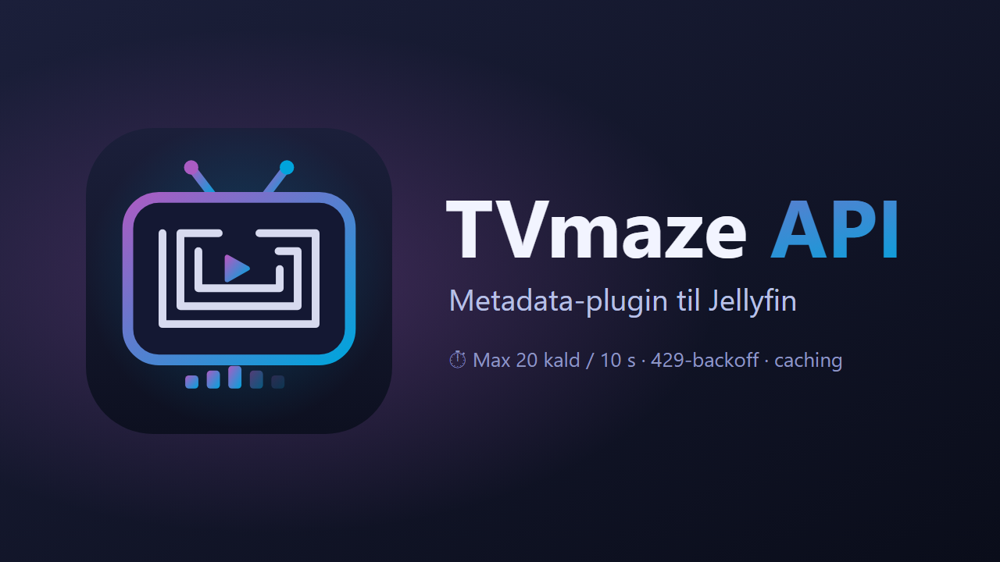

<p align="center">
  
</p>

# TVmaze API for Jellyfin

🇬🇧 English · 🇩🇰 [Dansk](README.da.md)

A metadata plugin for [Jellyfin](https://jellyfin.org) that gets series, season and episode data from the [TVmaze API](https://www.tvmaze.com/api) and stays within TVmaze's rate limit.

## Features

- **Series:** title, overview, genres, rating, premiere and end dates, status, air time and air days, network or streaming service, cast, creators, producers, and external IDs (TheTVDB, IMDb, TVRage).
- **Seasons:** name, overview, dates and poster.
- **Episodes:** title, overview, air date, runtime, rating, still image, guest stars, directors and writers. Specials (season 0) are matched in airing order, and daily shows can be matched by date.
- **Images:** posters, banners, backgrounds and logos.
- **Links** back to TVmaze on every item, including people.
- **Optional: mark watched episodes on TVmaze.** Link a Jellyfin user to a TVmaze account, and episodes you finish or mark as played are marked as watched on your TVmaze profile.

## Mark watched episodes on TVmaze (optional)

Metadata never needs an account. Linking an account is only for marking watched episodes on TVmaze, and writing to TVmaze requires TVmaze premium.

1. Go to **Dashboard → Plugins → TVmaze API**.
2. Under **TVmaze account**, choose the Jellyfin user, then fill in your TVmaze username and API key (found on your [TVmaze dashboard](https://www.tvmaze.com/dashboard)).
3. Click **Test login** to check the login and your premium level.
4. Tick **Mark watched episodes on TVmaze**, then click **Save**.
5. To send the episodes you have already watched, run **Sync watched episodes to TVmaze** under **Dashboard → Scheduled Tasks**.

Each Jellyfin user has their own TVmaze account. Episodes are sent in batches a few seconds after the last one, so marking a whole season played is a single call. Un-marking an episode in Jellyfin does not un-mark it on TVmaze.

## How the API rules are followed

| TVmaze rule | What the plugin does |
|---|---|
| At least 20 calls per 10 seconds per IP | A strict sliding window never sends more than 20 calls in any 10-second span. The limit can be changed in the settings. |
| HTTP 429 means: wait a bit and retry | On a 429, **all** calls pause (using `Retry-After`, or exponential backoff of 2, 4, 8 … up to 60 s), then the call is retried. 5xx errors are handled the same way. |
| Don't keep several idle connections open | One reused connection (HTTP/2 when available), closed after 30 seconds without use. |
| Responses are cached for 60 minutes | Responses are cached in memory for 60 minutes. Identical concurrent requests share one call, and errors are never cached. |
| Images may be cached or hotlinked | Images are fetched from the CDN outside the rate limiter. |
| Send a User-Agent | `Jellyfin-Plugin-TvMazeApi/<version>` |
| CC BY-SA 4.0 attribution | Every item links to TVmaze, and the settings page credits TVmaze. |

The plugin also makes few calls. Episodes are matched against the series' full episode list, which is **one** call per series, not one call per episode. Guest stars, directors and writers come from **one** call per season. A typical series costs about 6 calls plus one per season.

## Cast and crew

Jellyfin takes the list of people from the **first** metadata provider in your library settings that returns any. If TVmaze API is at the top, its cast replaces a longer cast from another provider, and people who are no longer linked to anything are later removed by Jellyfin's cleanup ("Deleting dead Person" in the log).

- If you want people from TheMovieDb, put **TVmaze API below TheMovieDb**. TVmaze then only fills in what is missing, and still adds TVmaze IDs to people who are already there.
- Or turn off **Provide cast and crew** in the plugin settings.

## Installation

Requires Jellyfin 12.2.

**From the plugin repository (recommended)**

1. In Jellyfin go to **Dashboard → Plugins → Repositories** (or *Catalog → ⚙️*) and add:
   ```
   https://raw.githubusercontent.com/Tntdruid/jellyfin-plugin-tvmaze-api/main/manifest.json
   ```
2. Open the **Catalog**, find **TVmaze API** and install it.
3. Restart Jellyfin.
4. In each TV library's settings, enable **TVmaze API** as a metadata and image provider.

**Manual**

1. Download the latest `.zip` from [Releases](https://github.com/Tntdruid/jellyfin-plugin-tvmaze-api/releases).
2. Unzip it into a folder named `TVmaze API_<version>` inside Jellyfin's `plugins` folder:
   - Windows: `C:\ProgramData\Jellyfin\Server\plugins\`
   - Linux: `/var/lib/jellyfin/plugins/`
   - Docker: `/config/plugins/`
3. Restart Jellyfin, then enable the provider as in step 4 above.

## Settings

| Setting | Default |
|---|---|
| Max calls per window | 20 |
| Window (seconds) | 10 |
| Cache (minutes) | 60 |
| Max retries on 429 | 5 |

## Development

```powershell
dotnet test
```

To release a new version, add a `## x.y.z` section to [CHANGELOG.md](CHANGELOG.md) and push a `vx.y.z` tag. The release workflow builds the zip, creates the GitHub release and adds the version to `manifest.json`.

## More Jellyfin projects

- [Episode Title Fixer](https://github.com/Tntdruid/jellyfin-plugin-episode-title-fixer): Jellyfin plugin that replaces placeholder episode titles like "Afsnit 11" with the original title.
- [Auto Artist Playlists](https://github.com/Tntdruid/jellyfin-plugin-auto-artist-playlists): Jellyfin plugin that hearts songs you listen to and adds them to a private playlist per artist.
- [TvFin](https://github.com/Tntdruid/TvFin): minimal Jellyfin player for Samsung Tizen TVs.
- [tonefin](https://github.com/Tntdruid/tonefin): small Windows music player for Jellyfin that always reports playback to the server.
- [Jellyfin Music Stats](https://github.com/Tntdruid/jellyfin-music-stats): Home Assistant add-on with music listening stats for Jellyfin.
- [Jellyfin Video Stats](https://github.com/Tntdruid/jellyfin-video-stats): Home Assistant add-on with viewing stats for movies, series and YouTube videos in Jellyfin.

## License

The code is licensed under GPL-3.0. Data from [TVmaze](https://www.tvmaze.com) is licensed under [CC BY-SA 4.0](https://creativecommons.org/licenses/by-sa/4.0/). This project is not affiliated with TVmaze.
